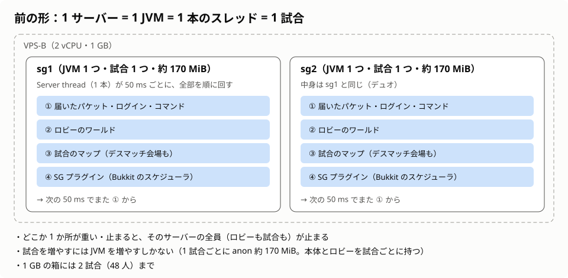
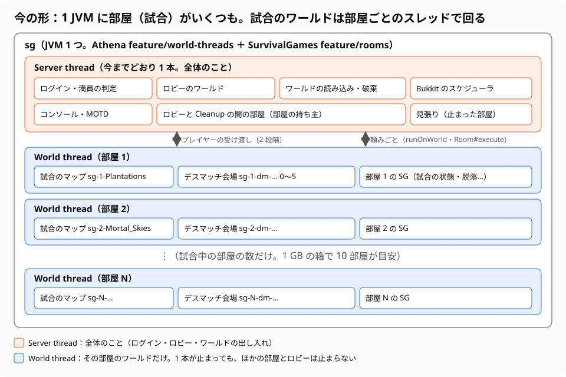
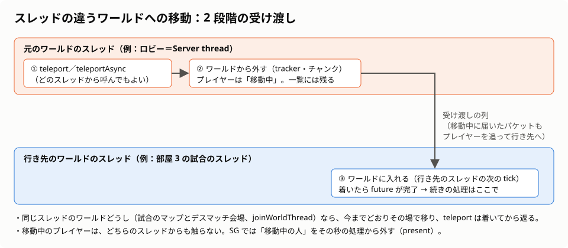
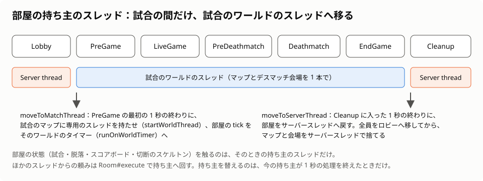
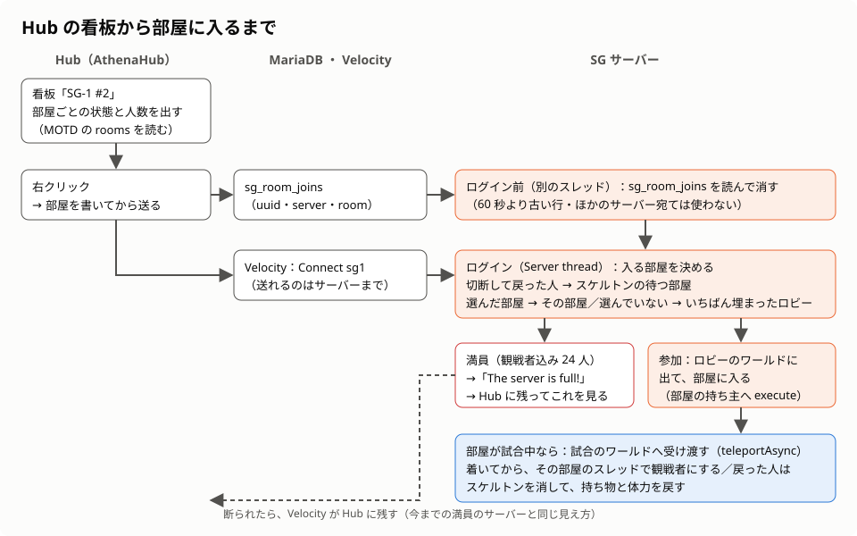
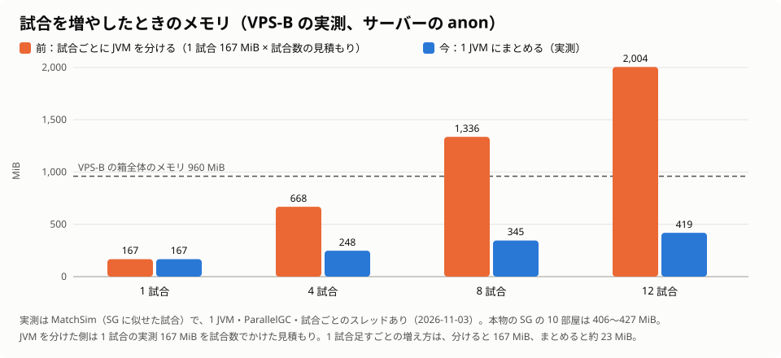

# Athena のワールドごとのスレッドと、SurvivalGames の部屋 — 前と今の設計

2026-11-04 時点の設計をまとめます。前の形は「1 本のメインスレッドで、1 つの試合だけを動かす」でした。それがどう変わったかを説明します。

| 部品 | ブランチ | 版 |
|---|---|---|
| Athena（サーバー） | `feature/world-threads` | server 0396・api 0062 |
| SurvivalGames（試合のプラグイン） | `feature/rooms` | 9f843e9（sg2 本番の `deploy/v2-dmarena-teams` を取り込み済み） |
| AthenaHub（Hub のプラグイン） | `feature/rooms` | 3ec4775 |

どれもまだ本番には入っていません（push もしていません）。経緯と試験の結果は `audit/2026-11-02/WORLD-THREADS-PLAN.md`・`audit/2026-11-02/world-threads/README.md`・`audit/2026-11-03/SG-ROOMS-PLAN.md` にあります。

---

## 1. まとめ

- **前**：1 つのサーバー（JVM）に、メインスレッド（`Server thread`）が 1 本だけでした。ログイン、パケット、ロビー、試合のマップ、プラグインを、そのスレッドが 50 ms ごとに順に回していました。1 サーバーで動かせる試合は 1 つです。試合を増やすには JVM を増やすしかなく、1 GB の箱では 2 試合が限界でした。
- **今の Athena**：選んだワールドに専用のスレッド（`World thread`）を持たせられます。そのワールドは自分のスレッドで tick し、そこにいるプレイヤーのパケットやコマンドも、そのスレッドで処理されます。1 本のスレッドが止まっても、ほかのワールドとメインスレッドは止まりません。
- **今の SG**：1 つの試合の流れを「部屋」（`Room`）にまとめ、1 つのサーバーに部屋をいくつも置けるようにしました。部屋は、ロビーの間はメインスレッドで動き、試合が始まると、試合のワールドの専用スレッドへ移ります。
- **結果**：1 GB の箱で、1 つの JVM に 10 部屋（240 人）が同時に 20 tick/s で動きました。1 つの部屋を 12 秒止めても、ほかの部屋とロビーは止まりませんでした。試合を 1 つ足すときのメモリは、JVM を分けると約 167 MiB、まとめると約 23 MiB です。

---

## 2. 前の形：1 サーバー = 1 JVM = 1 本のスレッド = 1 試合

Minecraft 1.8 のサーバー（PandaSpigot、それを元にした Athena）は、もともと 1 本のメインスレッドで動きます。

- メインスレッドは 50 ms ごとに次の順で回り、20 回で 1 秒（20 tick/s）です。
  1. 届いたパケットの処理
  2. 全ワールドの tick（ブロック・エンティティ・チャンク）
  3. 見える範囲の更新（tracker）
  4. Bukkit のスケジューラのタスク（プラグインの処理）
- すべてが 1 本のスレッドなので、プラグインは何も考えずにどのワールドもどのプレイヤーも触れました。その代わり、どこか 1 か所が重いと、そのサーバーの全員が待たされます。
- SurvivalGames（v1・v2）は、この前提で「1 サーバーで 1 試合」として作られていました。試合の状態（`Game`）、マップ（`Arenas`）、脱落（`Eliminations`）、スコアボードなどは、プラグインに 1 組ずつしかありませんでした。
- 本番の VPS-B（2 vCPU・1 GB）では、sg1（ソロ）と sg2（デュオ）を別々の JVM で動かしていました。1 つの JVM は約 170 MiB（anon）を使い、その中に JVM 自体、Minecraft の本体、ロビーのワールドを、試合ごとに 1 組ずつ重ねて持つ形でした。

---

## 3. 今の形：1 JVM に部屋がいくつも

| スレッド | 受け持つもの |
|---|---|
| `Server thread`（今までと同じ 1 本） | 接続の受け付けとログイン、プレイヤーの一覧への出入り、コンソールのコマンド、Bukkit のスケジューラ、ワールドの読み込みと破棄、サーバーの ping（MOTD）、オートセーブの指示、専用のスレッドを持たないワールド（ロビー）の tick |
| `World thread - <ワールド名>`（部屋の試合中だけ、部屋ごとに 1 本） | そのワールドの tick、そこにいるプレイヤーのパケット・コマンド・退出の処理、そのワールドのチャンクの読み込みの完了、そのワールドのタイマーのタスク（試合の進行） |
| 見張り（ウォッチドッグ） | 専用のスレッドが一定時間（既定 10 秒）tick を終えなければ、スタックを出して知らせる |
| `Athena GC request` | GC の頼みを受けて、tick のスレッドを待たせずに `System.gc()` を呼ぶ |

ロビー（既定のワールド）は、今もメインスレッドで回ります。ログインと復活の受け皿だからです。専用のスレッドを持つのは、プラグインが API（`Athena.startWorldThread`）で指定したワールドだけです。何も指定しなければ、今までの Athena と同じ動きになります。

---

## 4. Athena（サーバー）の変更

### 4.1 ワールドのスレッドと tick のループ

- メインスレッドの 50 ms のループを、ワールドのスレッド用にもう 1 つ作りました（`AthenaWorldThread`）。遅れの取り戻しと tick/s の計算は、ワールドごとに持ちます。
- メインスレッドは、専用のスレッドを持つワールドの tick を飛ばします。飛ばしたワールドの tick、tracker、時刻の送信は、そのワールドのスレッドが行います。
- 1 本のスレッドで、いくつかのワールドを回すこともできます（`Athena.joinWorldThread`）。SG では、試合のマップとデスマッチ会場を同じ 1 本で回します。同じスレッドのワールドどうしなら、今までどおりその場でテレポートできます。
- ワールドのスレッドで動く定期タスクには、`Athena.runOnWorldTimer` を使います。これはワールド自身の tick を数えるので、メインスレッドが遅れても試合の時計はずれません。SG の試合の 1 秒の進行は、これで回しています。

### 4.2 プレイヤーの処理は、そのプレイヤーのいるワールドのスレッドで

- パケット、接続の tick（キープアライブ・放置のキック）、コマンド、チャットの同期の部分、退出は、プレイヤーが今いるワールドのスレッドで処理します。
- 処理を待っている間にプレイヤーが別のワールドへ移っていたら、移った先のスレッドの列に入れ直します。
- ほかのスレッドからの `kickPlayer` は、プレイヤーのいるワールドのスレッドに渡して実行します。そのスレッドが固まっているときは、メインスレッドがその場で切断します。固まったワールドがあっても、そこのプレイヤーは抜けられ、もう一度ログインできます。

### 4.3 スレッドの違うワールドへの移動（2 段階の受け渡し）

前の形の移動は、1 つの関数の中で済んでいました。元のワールドから外し、行き先のワールドに入れるまでを一度に行っていたからです。行き先が別のスレッドのワールドだと、1 本のスレッドで両方を触れません。そこで、移動を 2 段階に分けました。

1. 元のワールドのスレッドで、ワールドから外します。プレイヤーは「移動中」になります。サーバーのプレイヤー一覧には残り、移動中に届いたパケットは、プレイヤーを追って行き先のスレッドへ回ります。
2. 行き先のワールドのスレッドの次の tick で、ワールドに入れます。

`Athena.teleportAsync` が返す future は、プレイヤーが着いたときに、行き先のスレッドで完了します。着いたあとの処理（持ち物を配る、観戦者にする、など）は、この future の続きに書きます。移動中のプレイヤーを、もう一度テレポートすることはできません。

### 4.4 共有の状態を、スレッドをまたいでも安全に

1.8 のサーバーは 1 本のスレッドが前提なので、途中の計算結果を static な変数に書いていました。2 本のスレッドが同時に動くと互いの値を壊すので、ここを直しました。

| 前 | 今 |
|---|---|
| 同期イベントを、全体で 1 つのロック（`SimplePluginManager` の `synchronized`）の中で呼ぶ。1 つのワールドが固まると、全スレッドのイベントが待つ | ロックを外した。登録の一覧は今もロックで守り、呼ぶ側は配列を読むだけ |
| ブロックの当たり判定の境界（階段・ハーフブロックなど）を、`Block` の共有オブジェクトに書いてすぐ読む | 境界は `Block.bounds()` から読む。登録が終わったあとに変えた境界は、スレッドごとの写しに書く |
| かまど・レッドストーン・階段の途中の状態、`instaFall` など、tick の途中で書き換える static | スレッドごとの状態（`AthenaThreadState`、ThreadLocal） |
| 全体の tick 数（`currentTick`）でクールダウンや間引きを測る | ワールドの tick 数で測る（メインスレッドが止まっても、試合の時計は進む） |
| チャンクの読み込みの完了処理を、メインスレッドで毎 tick 行う | そのチャンクのワールドのスレッドで行う |
| スコアボード、hide/show、変装・マスク・ボスバー | ロックで守るか、プレイヤーを持つスレッドで処理する |
| `AsyncCatcher`（メインスレッドかどうかを見る） | そのワールドを持つスレッドかどうかを見る |

### 4.5 止まったワールド・落ちたワールドの切り離し

- **停滞の見張り**：専用のスレッドが `worldThreadStallSeconds`（`athena.yml`、既定 10 秒）の間 tick を終えなければ、次のことをします。サーバーとほかのワールドは止まりません。
  - スタックをログに出す
  - `WorldThreadStallEvent` を出す
  - 回復したら、それも同じイベントで知らせる
- **例外の切り離し**：tick で例外が出たら、そのワールドのスレッドだけが止まります。そのあと次の順に処理します。
  1. `WorldThreadFailureEvent` を出す
  2. 残っているプレイヤーを、既定のワールドへ逃がす
- **止めきれないスレッド**：ワールドを捨てるときは、スレッドが止まるまで待ちます。待ちきれなければ、tick を終えたときにスレッドが自分でワールドを返します。
- **バニラのコマンド**（`/time`・`/tp` など、どのワールドでも触るもの）：全ワールドのスレッドを tick の間で止めてから、メインスレッドで実行します。

### 4.6 プラグインのための API（`athena.api.Athena`）

| API | 役目 |
|---|---|
| `startWorldThread(World)` | ワールドに専用のスレッドを持たせる |
| `joinWorldThread(World, World owner)` | `owner` を回しているスレッドで、このワールドも回す |
| `stopWorldThread(World)` | メインスレッドへ戻す（ワールドを捨てるときは自動） |
| `isWorldThreaded(World)`・`isWorldThread(World)` | 専用のスレッドを持つか、今のスレッドがそのワールドを回しているか |
| `runOnWorld(World, Runnable)` | そのワールドのスレッドで、次の tick の前に動かす。どのスレッドからでも呼べる |
| `runOnWorldTimer(World, Runnable, delay, period)` | そのワールドのスレッドで動く定期タスク。ワールドの tick を数える |
| `teleportAsync`・`teleportGradually` | ワールドをまたぐ移動。どのスレッドからでも呼べる |
| `loadTemplateWorld`・`pinChunks`・`preloadChunks` | 試合のマップをテンプレートから読む（読むのはメインスレッドだけ）。範囲のチャンクを固定・先読みする |
| `requestGarbageCollection()` | 呼んだスレッドを待たせずに GC を頼む（下） |

### 4.7 GC

- 1 つの JVM に試合を集めると、GC がすべての部屋を同時に止めてしまいます。
- VPS-B で GC を比べた結果、最良は次の組み合わせでした。
  - Shenandoah（世代なし）
  - `-XX:+ExplicitGCInvokesConcurrent`
  - ヒープは、生きたデータの約 2 倍（10〜12 試合で 320M）
- この組み合わせで、GC の停止は 3 ms 以下になりました。
- `System.gc()` を tick のスレッドで呼ぶと、並行 GC でも、呼んだスレッドだけはサイクルが終わるまで待たされます（ロビーが 300〜600 ms 止まった）。そこで専用のスレッドで呼ぶ `Athena.requestGarbageCollection()` を足し、SG は試合のあとこれを使います。

### 4.8 設計として残した制約

- 既定のワールド（ロビー）は、専用のスレッドにできません（ログインと復活の受け皿）。
- 一度例外で止まったワールドは、もう一度スレッドを持てません。捨ててテンプレートから読み直します。試合のマップはもともとそうしています。
- Timings は、最初のワールドのスレッドを始めた時点で止まります。計測には JFR を使います。
- 別のスレッドのワールドにあるベッドには復活しません。
- プレイヤー以外のエンティティが、スレッドの違うワールドへ移るとき、乗り物やリードは付いてきません。
- Bukkit の `World` の操作を、そのワールドを持たないスレッドから呼ぶのは、プラグインの責任です（`Athena.runOnWorld` を使う）。`World.getPlayers()` なども、持ち主のスレッドで読みます。
- ワールドごとの tick/s を取る API はまだありません。

試験用に、`-Dathena.threadCheck=true` を付けると、持ち主でないスレッドからの操作を記録する検出器が動きます。

---

## 5. SurvivalGames（プラグイン）の変更

### 5.1 部屋（`Room`）と部屋の一覧（`Rooms`）

前はプラグインに 1 組ずつだったものを、部屋ごとに 1 組ずつ持つようにしました。部屋の数は `config.yml` の `rooms` で決めます。

| 部屋ごとに持つもの | 中身 |
|---|---|
| `Game`・`StateFactoryImpl` | 試合の流れ（Lobby → PreGame → LiveGame → PreDeathmatch → Deathmatch → EndGame → Cleanup） |
| `Arenas` | 試合のマップ（`sg-{部屋}-{マップ}`）と、デスマッチ会場（`sg-{部屋}-dm-{会場}-{番号}`）。2 つの部屋が同じマップを同時に使える |
| `Eliminations`・`Disconnects` | 脱落の記録と、切断した生存者の代わりのスケルトン |
| `Scoreboards`・`CombatTracker` | スコアボード（「AS」には部屋の番号を出す）と、殴り合いの記録（`combat-log-{部屋}.csv`） |
| メンバー | この部屋にいる人（ロビーで待つ人・試合のプレイヤー・観戦者）。どのスレッドからも読める |

サーバー全体で 1 つのままのものは、次のとおりです。

- 戦績（`StatsService`。メソッドを `synchronized` にした）
- ランク、チャットの色、変装
- ロビーのワールド
- MOTD
- Hub から入る部屋の受け取り（`RoomJoins`）

### 5.2 部屋の持ち主のスレッド

- 部屋の状態を触るのは、その部屋の「持ち主のスレッド」だけです。
  - ロビーと Cleanup の間はメインスレッドです。プレイヤーはロビーのワールドにいます。
  - PreGame から EndGame までは、試合のワールドのスレッドです。プレイヤーはそのワールド（とデスマッチ会場）にいて、イベントもそのスレッドで届きます。
- 部屋の毎 tick の処理（`Room#tickIfOwner`）は、2 か所から呼ばれ、持ち主のスレッドで呼ばれたほうだけが動きます。
  - メインスレッドのスケジューラ
  - 試合のワールドのタイマー
- ほかのスレッドから部屋に頼むことは、`Room#execute` で持ち主のスレッドへ回します。
- 持ち主が替わるのは、今の持ち主が 1 秒の処理を終えたときだけです。
  - `moveToMatchThread`：PreGame の最初の 1 秒の終わりに、試合のマップにスレッドを持たせて移る
  - `moveToServerThread`：Cleanup の最初の 1 秒の終わりに戻る
- ある部屋の tick で例外が出ても、ログに残してその部屋だけを止めます。ほかの部屋は回り続けます。

### 5.3 リスナーとコマンドは部屋ごと

- リスナー（ロビー、カウントダウン、試合のイベント、チェスト、火打石、モブ、切断のスケルトン）は、部屋ごとに 1 組ずつ登録します。それぞれ、自分の部屋のプレイヤーと自分の部屋のワールドのイベントだけを扱います。ハンドラーの中身は前のままで、頭で「自分の部屋のものか」を見るだけです。
- `/vote`・`/team`・`/records` などのコマンドは、送った人の部屋の試合を見ます。
- `/disguise` は、自分の部屋がロビーのときだけ使えます（`DisguiseGate`）。前はサーバー全体で切り替えていました。
- 観戦コンパスのリスナーはサーバーに 1 つですが、使った人の部屋の試合だけを並べます。ほかの部屋の試合には移れません。

### 5.4 Hub から部屋へ

- **看板**：Hub の看板は、部屋ごとに結び付けます（`/athena sign sg1 2`）。SG の MOTD（JSON）に部屋ごとの状況（`rooms`）を足したので、看板は「SG-1 #2 / Lobby / 12/24」のように、部屋ごとの状態と人数を出せます。
- **部屋の受け渡し**：Velocity が送れるのはサーバーまでです。そこで Hub は、選んだ部屋を MariaDB の `sg_room_joins` に書いてから、プレイヤーを送ります。SG はログインの前に、その行を読んで消します。
- **入る部屋の決め方**：
  1. 試合中に切断して、スケルトンが待っている部屋があれば、その部屋へ戻します。
  2. 看板で部屋を選んでいれば、その部屋へ入れます。
  3. 選んでいなければ、ロビーで待っている人がいちばん多く、空きのある部屋へ入れます。
- **満員**：部屋は観戦者も含めて 24 人で満員です。入る部屋が満員なら、ログインを「The server is full!」（spigot.yml の `messages.server-full`）で断ります。断られた人は Hub に残ってこのメッセージを見るので、前の満員のサーバーと同じ見え方です。
- **試合中の部屋に入ったとき**：ロビーのワールドに出たあと、試合のワールドへ受け渡されます。着いてから、その部屋のスレッドで観戦者になります。

### 5.5 sg2 本番から取り込んだ機能の、部屋への合わせ方

sg2 本番（`deploy/v2-dmarena-teams`）は、1 サーバー 1 試合の前提で作られていました。部屋の版に取り込むときに、次のように合わせました。

| 機能 | 合わせ方 |
|---|---|
| デスマッチ会場（トーナメントの試合を同時に戦う） | 会場のワールドの読み込みと破棄は、メインスレッドでしかできない。部屋が試合のスレッドにいる間は、メインスレッドに頼んで読み込み、試合のマップと同じスレッドに入れてから（`joinWorldThread`）部屋に渡す。ゲートは会場のワールドのタイマーで開ける |
| 切断した人の代わりのスケルトン | 部屋ごとに持つ。戻ってきた人は、ほかの部屋を選んでいても、スケルトンの部屋に入る。先にスケルトンの位置へ移し、着いてから（試合のスレッドで）持ち物と体力を戻す |
| 観戦コンパス | 戦っている試合の一覧を、サーバーに 1 つの static から、部屋のデスマッチごとの一覧にした |

### 5.6 スレッドをまたぐときの決まり（SG の中）

- プレイヤーを触るのは、そのプレイヤーのいるワールドのスレッドで行います（`PlayerThreads.run`・`nextTick`）。
- ワールドをまたいで移した人に何かするのは、`teleportAsync` の完了の続き（行き先のスレッド）で行います。
- 試合の人を毎秒触る処理（ボスバー、範囲の外の警告、雷、組み合わせへの配置など）は、`present(id)` が返す人だけを触ります。対象は、オンラインで、切断中でなく、この部屋のスレッドのワールドにいる人です。移動中の人は、その秒は飛ばします。
- 先読みの完了など、メインスレッドで返ってくるものの続きは、部屋のスレッドへ戻してから行います（`Arenas#onRoomThread`）。
- 試合のあとの GC は `Athena.requestGarbageCollection()` で頼み、呼んだスレッドを待たせません。
- 部屋をまたいで読まれる表は、どのスレッドからも安全な表にしました。対象は、部屋のメンバー、切断中かどうか、スケルトンの持ち主、会場の一覧などです。

---

## 6. 数字で見る違い

VPS-B（ConoHa、2 vCPU・1 GB）で、本番の起動スクリプト・設定・マップを使い、ボットで計りました。

| 確かめたこと | 結果 |
|---|---|
| 1 JVM に試合を足したときのメモリ（MatchSim） | 1・4・8・12 試合で 167・248・345・419 MiB。1 試合足すごとに約 23 MiB（JVM を分けると約 167 MiB） |
| 本物の SG、10 部屋・240 体・各 2 試合 | 全員が完走。一番遅い部屋も 20 tick/s。全体を止める GC 0 回。anon 427 MiB、箱の空きは最小 113 MiB |
| 本物の SG、12 部屋・288 体 | 動くが、ヒープ 320M が足りず、全体を止める GC が 1 回（1.8 秒）、swap 220 MiB。1 GB の箱の目安は 10 部屋 |
| 部屋 3 を 12 秒止める | 止まったのは部屋 3 だけ。ほかの 11 部屋とロビーは 20 tick/s。見張りは 10.8 秒で報告 |
| ロビー（メインスレッド）を 4 秒止める | 12 部屋とも 20 tick/s のまま |
| デュオ・5 マップ混在、10 部屋 | 全員が完走。19.95 tick/s 以上。全体を止める GC 0 回 |
| 1 時間半・150 試合（10 部屋・5 マップ混在） | 全員が 15 試合を完走。GC のあとのヒープと anon は最初から最後まで横ばい（漏れなし） |
| 10 部屋が同時に戦っている間のサーバーの CPU | 約 0.6 コア（2 vCPU のうち） |
| Hub・Velocity を通して入る（手元） | 選んだ部屋に入る。満員は「The server is full!」で断る。切断して戻った人は自分の試合に戻る。不正なスレッドからの操作 0 件 |

---

## 7. 前と今の比較

| | 前 | 今 |
|---|---|---|
| 1 JVM の試合 | 1 つ | 部屋の数だけ（1 GB の箱で 10） |
| スレッド | メインスレッド 1 本ですべて | メインスレッド（全体とロビー）＋ 試合中の部屋ごとに 1 本 |
| 1 か所が重い・止まると | そのサーバーの全員が止まる | その部屋だけが止まる。見張りが知らせる |
| tick の例外 | サーバーごと落ちる | そのワールドのスレッドだけが止まり、プレイヤーはロビーへ逃げる |
| 試合を 1 つ足すメモリ | JVM 1 つ（約 167 MiB） | 約 23 MiB |
| ワールド間の移動 | その場で終わる | スレッドが違えば 2 段階。着いたら future が完了 |
| プラグインの書き方 | どのスレッドからでも何でも触れる | 部屋の持ち主のスレッドで部屋を、プレイヤーのいるスレッドでプレイヤーを触る |
| Hub の看板 | サーバーごと | 部屋ごと（状態と人数、選んだ部屋に入る） |
| 満員 | サーバーの `max-players` | 部屋ごとに 24 人（観戦者込み）。断られ方は同じ |
| GC | ParallelGC、試合のあとにメインスレッドで `System.gc()` | Shenandoah ＋ 並行の明示 GC、専用のスレッドで頼む |

---

## 8. まだのこと

- **計測**：sg2 の設定（デュオ・トーナメント・会場）で 10 部屋を、VPS-B で計り直す。前の 2 回は、Mac への回線（2.1 Mbit/s）が遅く、ボットが時間切れになった。
- **本番に入れる準備**：
  - ブランチの push とマージ
  - `server.properties` の `max-players` を「部屋の数 × 24」にする
  - `rooms`・`server-name` を設定する
  - 起動フラグを Shenandoah・ヒープ 320M にする
  - DB のユーザーに `sg_room_joins` の権限を与える
  - Hub の看板を部屋ごとに張り直す
- **本物のクライアントでの確認**：試験はすべてボット。変装・ランク・看板などを、人の手で一度確かめる。
- **Shady_Hollow の End の遅さ**：日光センサーの街灯が、End で夜にしたときに一斉に点き、その部屋が 0.5〜1.7 秒止まる。時刻を夜にする処理は v2 から元々あるので、今の本番でもサーバーごと同じだけ止まっているはず（本番では確かめていない）。部屋の版では、その部屋だけが止まる。直し方はまだ決めていない。
- **起動直後のロビーの 4 秒**：一度だけ起きた。原因は分かっていない。
- **Athena の見直しで直していない 2 件**：ワールドごとの tick/s の API がないこと。`World.players` を、持ち主のスレッドで読む決まりにしただけであること。
